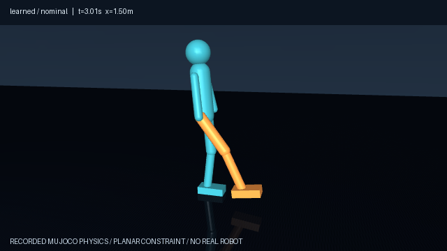

# Humanoid Walk Lab

A simplified humanoid **learns a walking gait in MuJoCo** using cross-entropy policy search. The project includes an original robot model, CPU training code, learned parameters, reproducible evaluation, and recorded physics replays in an interactive report.



**Scope:** this is a planar humanoid with six powered leg joints and fixed arms. It learns 16 parameters of a hand-designed periodic controller with feedback. It is not a full 3D humanoid benchmark, a neural policy trained from scratch, or a real-robot controller.

## Results

The initial controller fell in all 20 normal evaluation trials. After 4,800 training rollouts, the frozen controller completed all 20 normal twelve-second trials, traveling **7.10 m on average at 0.59 m/s**. It failed every backward-push trial; that failure is included in the report.

| Controller / condition | Walking success | Falls | Mean distance | Mean speed | Mean duration |
| --- | ---: | ---: | ---: | ---: | ---: |
| Initial / normal ground | 0/20 | 20 | 0.60 m | 0.32 m/s | 1.88 s |
| Learned / normal ground | 20/20 | 0 | 7.10 m | 0.59 m/s | 12.00 s |
| Learned / low friction | 20/20 | 0 | 8.93 m | 0.74 m/s | 12.00 s |
| Learned / forward push | 20/20 | 0 | 7.76 m | 0.65 m/s | 12.00 s |
| Learned / backward push | 0/20 | 20 | 0.62 m | 0.20 m/s | 3.11 s |

Speed and distance include failed trials. Walking success requires no fall for the full horizon, mean speed between 0.25 and 1.2 m/s, at least eight alternating landings, and at least four landings per foot after 40 ms airborne. Standing still and sliding without stepping do not satisfy those criteria; the check does **not** establish slip-free walking. Low-friction success also does not imply accurate target-speed tracking.

All clips show the first evaluation seed in each group, not a selected best result. The video is a rendering of saved MuJoCo states, not a scripted root-position animation. The browser report plays recorded trials; it does not perform live simulation or training.

## Watch the demo

After cloning or extracting the project, open `reports/report.html` in a browser. Keep the neighboring MP4 files in place. Alternatively:

```powershell
python -m http.server 8776 --bind 127.0.0.1 --directory reports
```

Open [the local report](http://127.0.0.1:8776/report.html). Use the scenario menu to compare before training, normal walking, slippery ground, and forward/backward pushes. The report includes a training curve, foot-contact timelines, speed traces, and all evaluation summaries. Viewing saved results needs no MuJoCo installation.

## Install

Python 3.11+; tested with Python 3.12.14 and MuJoCo 3.3.7 on Windows. From the repository root:

```powershell
python -m venv .venv
.venv\Scripts\python -m pip install -e ".[render]"
```

Use `.venv/bin/python` on Linux/macOS. For the recorded package versions, install `requirements-lock.txt` before the editable project. MuJoCo ships its engine with the Python package; see its [official Python documentation](https://mujoco.readthedocs.io/en/stable/python.html).

**Windows DLL note:** MuJoCo needs the Microsoft C++ runtime. If importing it reports a missing `mujoco.dll` dependency, use Microsoft's [supported Visual C++ Redistributable guidance](https://learn.microsoft.com/en-us/cpp/windows/latest-supported-vc-redist?view=msvc-170). On the development computer, an existing trusted C++ runtime was registered for the Python process using `WALK_LAB_DLL_DIR`; no system DLLs were replaced. Advanced users with an existing runtime can set this variable to its directory before running the commands. No DLLs are redistributed in this repository.

Training and evaluation require no display or GPU. Video rendering requires a working OpenGL context; Linux headless machines may need the appropriate MuJoCo rendering backend. Saved videos remain available if local rendering is unavailable.

## Train, evaluate, and render

```powershell
# Train the same configuration as the published experiment.
.venv\Scripts\python -m walk_lab.train --out runs/training --generations 50 --population 48 --workers 4 --seed 42 --seconds 6

# Evaluate your newly trained policy without replacing the published report.
.venv\Scripts\python -m walk_lab.evaluate --policy runs/training/policy.json --out reports/custom --count 20 --seconds 12
.venv\Scripts\python -m walk_lab.render --out reports/custom

# Or evaluate the bundled frozen policy.
.venv\Scripts\python -m walk_lab.evaluate --policy artifacts/policy.json --out reports/custom

# Automated physics and metric checks; no renderer required.
.venv\Scripts\python -m unittest discover -s tests -v
```

Default training uses four worker processes. Use `--workers 1` to reduce CPU use. The measured training run took approximately 99 seconds on an Intel i7-1185G7 laptop; this is a single observed runtime, not a performance guarantee. `--resume PATH` warm-starts a new search around saved parameters; it does not restore optimizer/RNG state or continue the original history exactly.

The optional console commands are `walk-train`, `walk-evaluate`, and `walk-render`. `render --html-only` rebuilds the report from existing JSON without recreating videos; videos must already match those recorded states. Keep the default twelve-second evaluation horizon when comparing against the published success criterion, which requires a fixed minimum number of steps.

## Model and controller

The original MJCF model has a torso, head, fixed arms, two thighs, shins, and feet. Its root can translate forward and vertically and rotate in pitch; lateral translation, roll, and yaw are constrained. Hip, knee, and ankle motors on both legs drive the motion. Self-collision is disabled; ground contact is enabled.

- Physics step: 2 ms, implicit-fast integration, gravity 9.81 m/s².
- Control interval: 10 ms, five physics steps per action.
- Torque limits: ±80 Nm at hips/knees and ±35 Nm at ankles.
- Initial pitch: uniform ±0.015 radians; initial generalized velocities: normal distribution with standard deviation 0.01.
- Fall: pelvis height below 0.48 m, absolute pitch above 1 radian, or nonfinite state.
- Nominal friction: 0.9; low-friction evaluation: 0.35.
- Push: ±80 N along the forward axis for 0.1 seconds starting at t = 2 s, applied to the torso/pelvis body.

Each leg follows a shared bias + sine + cosine + second-harmonic target, with half-cycle phase separation. Hip targets include pitch/angular-velocity feedback; ankle targets include pitch and forward-speed feedback. A proportional-derivative controller produces bounded joint torques. The optimizer learns frequency, 12 waveform coefficients, and three feedback gains. The controller structure, gains of the joint PD loops, reward, and planar constraint are engineered priors.

The reward is integrated over each control interval:

```text
r = [0.3 + 1.5 exp(-((forward_speed - 0.6) / 0.45)^2)
     - 0.8 pitch^2 - 0.0004 sum(abs(joint_torque * joint_velocity))] * dt
```

The energy term is a sampled absolute mechanical-work proxy, not electrical battery consumption. Early falls end a rollout and forgo future rewards. There is no explicit foot-step reward; contact-based walking criteria are evaluation checks.

Cross-entropy search evaluates 48 candidates on training seeds 11 and 22, retains the best eight, and smooths updates to a diagonal Gaussian search distribution for 50 generations. The best candidate and distribution mean are retained in each population; standard deviations have a nonzero floor. This is direct policy search, not backpropagation through MuJoCo. The method follows the broad approach described by [Mannor, Rubinstein and Gat (ICML 2003)](https://cdn.aaai.org/ICML/2003/ICML03-068.pdf).

## Evaluation protocol and limitations

One optimizer seed (42) was trained. The saved policy was frozen before evaluation. Normal-condition seeds are 100–119 (shared by initial/learned policies); low-friction seeds 200–219; forward-push seeds 300–319; backward-push seeds 400–419. These do not overlap training seeds. Different stress groups have different initial seeds, so their differences are not a paired causal estimate. All 100 trial results are published; no failed evaluation trials were discarded.

Before the final evaluation, development included a controller feedback-sign correction and inspection of a mid-training controller on training seed 11. The contact qualification and success rule were defined before the held-out run. The policy was not retrained after seeing the backward-push failures.

The test set covers a narrow family of small initial perturbations on flat ground. Twenty successes do not prove universal reliability. No results are claimed for full 3D balance, uneven terrain, self-collision, sensor noise/delay, actuator realism, neural learning from scratch, or transfer to hardware. The next research step would be training over broader disturbances with a separately reserved evaluation set.

## Files

| Path | Contents |
| --- | --- |
| `walk_lab/humanoid.xml` | Original planar robot and ground physics |
| `walk_lab/sim.py` | Controller, rollouts, fall/contact metrics |
| `walk_lab/train.py` | Cross-entropy training |
| `walk_lab/evaluate.py` | Frozen-policy evaluation |
| `walk_lab/render.py` | State replay renderer and report builder |
| `artifacts/policy.json` | Learned parameters and all 50 generation summaries |
| `reports/evaluation.json` | 100 trial results, summary, versions, model/policy hashes |
| `reports/replays.json` | Recorded states for five first-seed examples |
| `reports/*.mp4` | Rendered replays |
| `tests/test_walk.py` | Physics, control, reset, and evaluation tests |

See [VALIDATION.md](VALIDATION.md) for checks and CI status, and [ATTRIBUTION.md](ATTRIBUTION.md) for sources and licenses.
